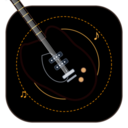

# GarageBand for Windows



**GarageBand for Windows** is Apple's iconic music creation studio brought to Microsoft Windows 10/11. Record, edit, and produce songs, podcasts, and audio projects using virtual instruments, loops, and professional-quality effects. 🎵🎤🎹

Clean, safe, 100% virus-free real `.exe` and `.msi` Windows installer.

---

## Features

- 🎹 **Virtual Instruments**: Grand Piano, Polyphonic Synth, Electric Guitar, Deep Sub Bass, and Drum Kits.
- 🔄 **Apple Loops Library**: Pre-loaded with multi-track royalty-free studio beats, piano chords, cyberpunk arps, guitar riffs, and basslines.
- 🥁 **Beat Sequencer**: 16-step rhythmic drum sequencer and playable MPC-style drum pads.
- 🎛 **Real-time Studio Effects**: Master Reverb, Stereo Delay / Echo, Distortion Overdrive, and EQ.
- 🎚 **Multi-Track Mixing**: Individual track volume sliders, solo, and mute controls with color-coded audio clips.
- 💻 **Real Native Windows Executable (.exe)**: Compiled 64-bit PE32+ executable with custom embedded icons and Windows version metadata.
- 📦 **Standard Windows Installer (.msi)**: Clean, silent-install capable MSI with Start Menu and Desktop shortcuts.

---

## Installation & Distribution Files

The compiled release packages are located in `dist/release/`:

| File | Description |
|---|---|
| `GarageBand.exe` | Real PE32+ 64-bit native Windows executable |
| `GarageBand-Setup.msi` | Standard Windows Installer package (MSI) |
| `GarageBand-Windows-Portable.zip` | Self-contained portable distribution with all shared dependencies |

### Installing via MSI
Double click `GarageBand-Setup.msi` or run in command prompt:
```cmd
msiexec /i GarageBand-Setup.msi /qb
```

---

## Building from Source

Requirements:
- Linux or Windows with `gcc-mingw-w64`, `wixl` (`msitools`), and `nodejs`.

```bash
# Build executable (.exe)
bash build-scripts/build-exe.sh

# Build MSI installer (.msi)
bash build-scripts/build-msi.sh

# Build all release packages
bash build-scripts/build-all.sh
```

## Running the Web DAW Live
```bash
npm start
# Opens at http://localhost:3000
```
